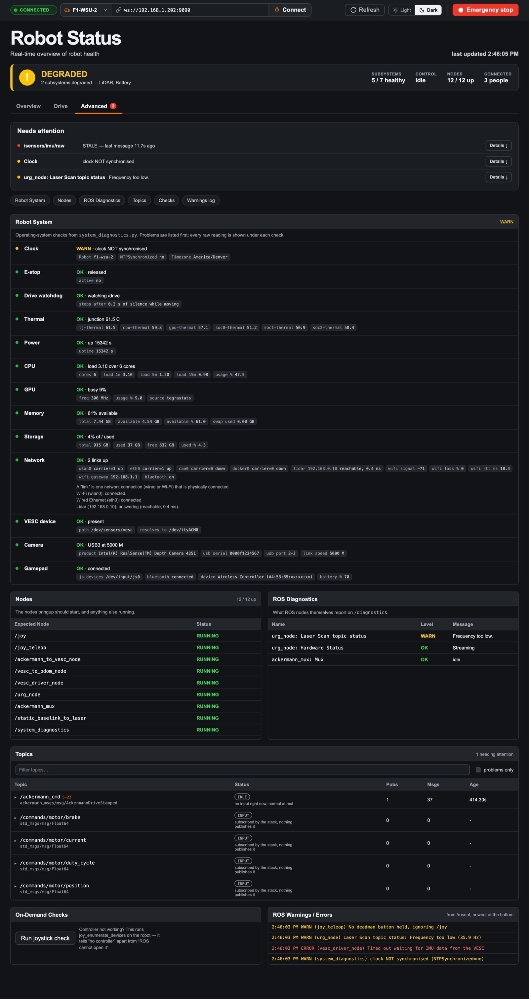
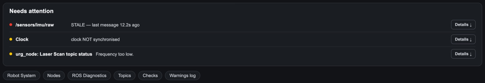
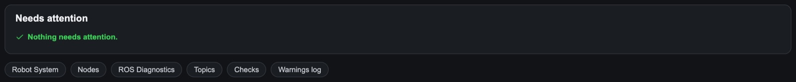
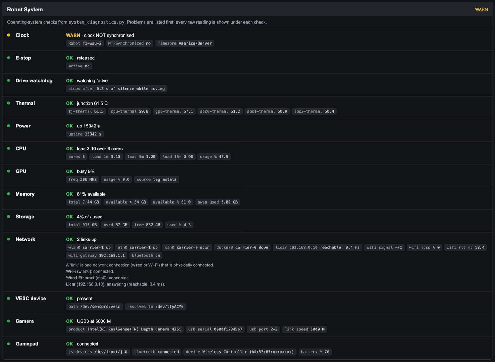
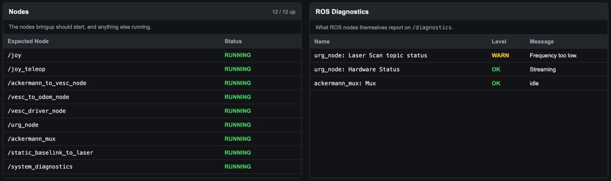
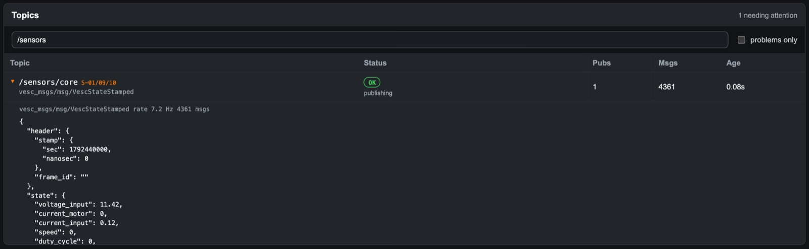
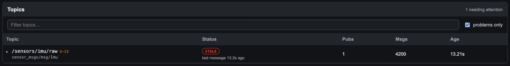
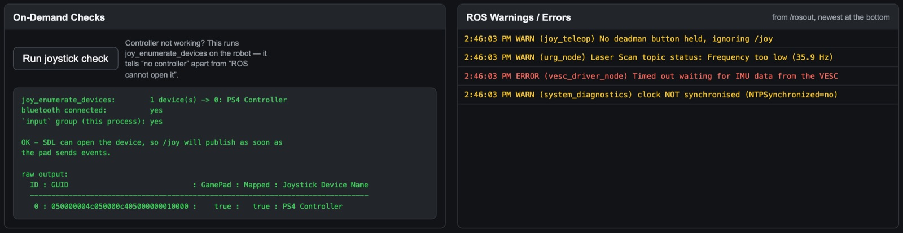
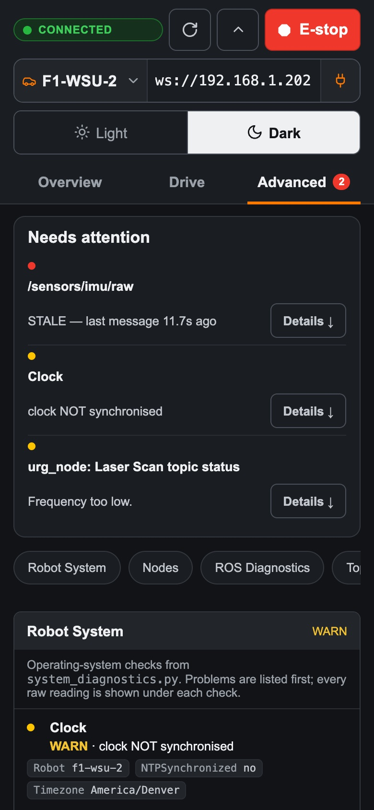

=====================================
The Advanced tab: a user guide
=====================================

How to use the dashboard's detail page to find out *why* something is wrong:
every warning in one list, every check the car runs on itself, every ROS node
and topic, a controller test, and the car's warning log.

This guide is for **people fixing a car**: whoever is debugging a car that is
not HEALTHY, and developers checking that their own nodes run. It assumes you
have read the :doc:`Overview guide <overview-tab>`; driving is in
:doc:`drive-tab`.

*The screenshots in this guide are from the real dashboard with a simulated
robot. The car here is DEGRADED on purpose: its battery is low, its LiDAR is a
little slow, its clock is not synchronised, and its IMU topic has stopped, so
each section has something to show.*

.. contents:: Contents
   :local:
   :depth: 1

.. _advanced-needs-attention:

Needs attention
===============

**Start here.** Every problem the tables below contain, in one list, **worst
first**: red (error) before amber (warning). Each line says what and why, and
**Details ↓** jumps to the section that explains it.

It collects:

- **A check that warns or fails**, from the car's own checks or a ROS node's
  (Clock, *urg_node: Laser Scan topic status*).
- **An expected node that is not running**.
- **A topic in a bad state** (``/sensors/imu/raw`` *STALE — last message 11.7s
  ago*).
- **Not connected**, when the page cannot reach the car.

When everything is fine:

The row of buttons under the list jumps to each section: **Robot System**,
**Nodes**, **ROS Diagnostics**, **Topics**, **Checks**, **Warnings log**.

The number on the **Advanced** tab counts the warnings and errors from checks
only (2 here). Node and topic problems show in this list but not in the number.

.. _advanced-robot-system:

Robot System
============

The checks ``system_diagnostics.py`` runs on the car's operating system, things
ROS does not report itself. Each line is one check: its verdict (**OK**,
**WARN**, **ERROR**, or grey **STALE**, meaning *not checked yet*), a one-line
message, and **every raw reading** underneath. Problems are listed first; the
summary at the top right is the worst of them.

.. list-table::
   :header-rows: 1
   :widths: 16 34 50

   * - Check
     - What it watches
     - Warns or fails when
   * - **E-stop**
     - Whether the emergency stop is on
     - **ERROR** while it is on: *EMERGENCY STOP ACTIVE since …*
   * - **Drive watchdog**
     - Commands from dashboards on ``/drive``
     - **WARN** for a minute after it had to stop the car because ``/drive``
       went quiet for 0.3 s while moving
   * - **Thermal**
     - Every temperature sensor on the Jetson
     - **WARN** at 70 °C, **ERROR** at 85 °C (junction)
   * - **Power**
     - How long the computer has been on
     - **ERROR** *REBOOTED - uptime went backwards (brownout?)*: the board
       restarted, usually because the battery sagged
   * - **CPU**
     - Load average against the number of cores
     - **WARN** above 1 per core, **ERROR** above 2 per core
   * - **GPU**
     - How busy the graphics processor is
     - **WARN** at 95 % for 5 s
   * - **Memory**
     - Free memory
     - **WARN** below 20 % free, **ERROR** below 10 %
   * - **Storage**
     - Disk space on ``/``
     - **WARN** at 85 % used, **ERROR** at 95 %
   * - **Network**
     - Every network link, the LiDAR's ping, Wi-Fi quality, Bluetooth
     - **ERROR** *lidar unreachable at 192.168.0.10*, or no network link at all
   * - **VESC device**
     - The motor controller's USB serial device
     - **ERROR** */dev/sensors/vesc missing*: the VESC is unplugged or not
       powered
   * - **Camera**
     - The RealSense on USB
     - **WARN** when it runs on USB 2 (*enumerated at 480 M - expected 5000*),
       **ERROR** when it is not found
   * - **Gamepad**
     - The PS4 controller over Bluetooth
     - **WARN** *js device but no BT link* (normal for a few seconds after
       pairing); **ERROR** when it is connected but ROS cannot read it. *No
       controller connected* is **OK**: it is not a fault
   * - **Clock**
     - Whether the clock is synchronised over the network
     - **WARN** *clock NOT synchronised*: log times and bag files will be off

The **Network** check also says each link in plain words: *Wi-Fi (wlan0):
connected. Wired Ethernet (eth0): connected. Lidar (192.168.0.10): answering.*
The LiDAR has its own Ethernet cable, so "Wired Ethernet" being down usually
means the LiDAR's cable is out.

The Overview's CPU, RAM, GPU and Temperature tiles show the headline of these
same checks. This is the detail behind them.

If the card says *Waiting for system_diagnostics*, the service is not running
on the car. Start it with ``~/diag/start_diagnostics.sh``.

.. _advanced-nodes:

Nodes
=====

The **12 nodes bringup should start**, each **RUNNING** or **NOT RUNNING**, and
the count up at the top right. Scroll the card to see all 12:

.. list-table::
   :header-rows: 1
   :widths: 35 65

   * - Node
     - What it is
   * - ``/joy``, ``/joy_teleop``
     - Read the PS4 controller and turn it into drive commands
   * - ``/ackermann_mux``
     - Picks who drives: the controller (always first) or navigation and
       dashboards
   * - ``/ackermann_to_vesc_node``
     - Turns drive commands into motor and steering commands
   * - ``/vesc_driver_node``
     - Talks to the VESC; reports the battery and faults
   * - ``/vesc_to_odom_node``
     - Works out speed and position from the motor
   * - ``/urg_node``
     - The LiDAR driver
   * - ``/static_baselink_to_laser``
     - Where the LiDAR sits on the car
   * - ``/system_diagnostics``
     - The car's own checks, the emergency stop and the drive watchdog
   * - ``/rosbridge_websocket``, ``/rosapi``, ``/rosapi_params``
     - What the dashboard talks to

Under the table, **also running** lists any other node (here ``/rviz2``). That
is usually harmless, and occasionally the explanation: a second copy of a node
fighting over the same topic.

.. _advanced-ros-diagnostics:

ROS Diagnostics
===============

What ROS nodes report **about themselves** on ``/diagnostics``: each entry's
name, level (OK, WARN, ERROR, STALE) and message. In the screenshot, the LiDAR
driver says its scan rate is too low (*Frequency too low.*).

The car's own checks (Robot System, above) travel on the same topic but are
listed there instead.

.. _advanced-topics:

Topics
======

Every topic the dashboard knows about, its state, its number of
**publishers**, **messages** received since the page opened, and the **age** of
the last one.

- **Filter topics…** narrows the list by name.
- **Problems only** hides everything that is fine.
- **Click a row** to open it: it shows the live message (here the VESC's
  battery and motor readings), its type, and its rate. An open row updates 10
  times a second. Click again to close it.
- The orange tags (**S-01/09/10**, **S-12**) are the subsystem IDs from
  :doc:`../design/subsystem-inventory`.

What the states mean
--------------------

A single rule ("no message recently = broken") would flag most topics on a
healthy car, because many only publish when someone is driving. So the
dashboard knows what kind of topic each one is.

.. list-table::
   :header-rows: 1
   :widths: 20 55 25

   * - State
     - Meaning
     - A problem?
   * - **OK**
     - Publishing (or, for a command topic, input arriving)
     - No
   * - **IDLE**
     - A command topic with nothing to say: nobody is driving. For ``/odom``
       and ``/tf``, waiting for the first steering command
     - No, normal at rest
   * - **INPUT**
     - The car listens on it, and nothing publishes it. Normal for ``/drive``
       and ``/commands/motor/*``
     - No
   * - **DRIVEN**
     - Something is publishing commands to an input topic
     - No, but someone is driving
   * - **WAITING**
     - A send-once topic that has not sent yet
     - Not yet; it should change to OK
   * - **STALE**
     - Was publishing, then stopped (*last message 11.7s ago*)
     - **Yes**
   * - **SILENT**
     - Has a publisher but has never sent a message
     - **Yes**
   * - **NODE_DOWN**
     - The topic exists but nothing publishes it
     - **Yes**
   * - **NOT_ADVERTISED**
     - The node that should publish it runs, but does not offer it
     - **Yes**
   * - **MISSING**
     - Not in the ROS graph at all; its node is not running
     - **Yes**
   * - **ABSENT**
     - An input topic nobody has created
     - No

To save bandwidth the page samples most topics 5 times a second, so the message
counts are the page's samples, not every message the car sent. ``/scan`` alone
runs at about 780 KB/s at full rate.

.. _advanced-on-demand-checks:

On-Demand Checks
================

**Run joystick check** is for *"the controller is paired but the car does not
respond"*. It runs ``joy_enumerate_devices`` on the car and tells three cases
apart:

.. list-table::
   :header-rows: 1
   :widths: 30 35 35

   * - Result
     - Meaning
     - What to do
   * - **OK** - *SDL can open the device, so /joy will publish as soon as the
       pad sends events*
     - The controller works as far as ROS is concerned
     - Hold L1 (deadman) while driving
   * - **CONTRADICTION**: *the pad is paired and connected, but SDL cannot open
       it*
     - Bluetooth is fine, but ROS is not allowed to read it
     - On the car: ``sudo usermod -aG input $USER``, log out and back in,
       restart bringup
   * - *No controller is connected*
     - Nothing is paired
     - Pair the controller (hold PS + Share), then run the check again

It takes a few seconds. If it says the service does not exist,
``system_diagnostics.py`` is not running or is an old copy: run
``~/diag/start_diagnostics.sh``.

.. _advanced-ros-warnings:

ROS Warnings / Errors
=====================

Every **WARN**, **ERROR** and **FATAL** message any ROS node logs (from
``/rosout``), with the time and the node's name, **newest at the bottom**.
Errors are red, warnings amber. Info and debug messages are left out.

It only holds messages from since the page was opened. It keeps following new
messages while you are at the bottom; scroll up to read and it stays where you
are.

.. _advanced-phone:

On a phone
==========

On a phone the cards stack in one column, each Needs attention item gets its
own block, and the section buttons scroll sideways.

.. _advanced-worked-example:

Worked example: the controller does nothing
===========================================

A student says the controller is paired but the car won't move.

1. **Overview → Subsystems → Controller.** *connected*, HEALTHY. So Bluetooth
   works.
2. **Overview → banner → Control.** *Idle*: the mux hears no deadman. If it
   said *Navigation / web*, something else would be driving.
3. **Advanced → Topics →** ``/joy``. **IDLE** when nobody touches the
   controller. Press a button and it should turn **OK**. If it stays IDLE while
   buttons are pressed, ROS cannot read the controller.
4. **Advanced → Run joystick check.** *CONTRADICTION* confirms it: add the user
   to the ``input`` group, log out and in, restart bringup.
5. **Advanced → Nodes.** If ``/joy`` or ``/joy_teleop`` is NOT RUNNING, restart
   bringup instead.

The same pattern works for any problem: the Overview says **what**, Needs
attention says **where**, and the section it links to says **why**.