=====================================
The Drive tab: a user guide
=====================================

How to drive a RoboRacer from the dashboard: what is on the screen, how to arm
and drive, what stops the car, how to arrange the view, and how it works on a
phone.

This guide is for **people driving the car**. How the commands reach the
motors, and where each piece lives in the code, is in
:doc:`../design/dashboard-drive-control`. The emergency stop has its own page,
:doc:`../design/emergency-stop`. The other tabs have their own guides:
:doc:`overview-tab` and :doc:`advanced-tab`.

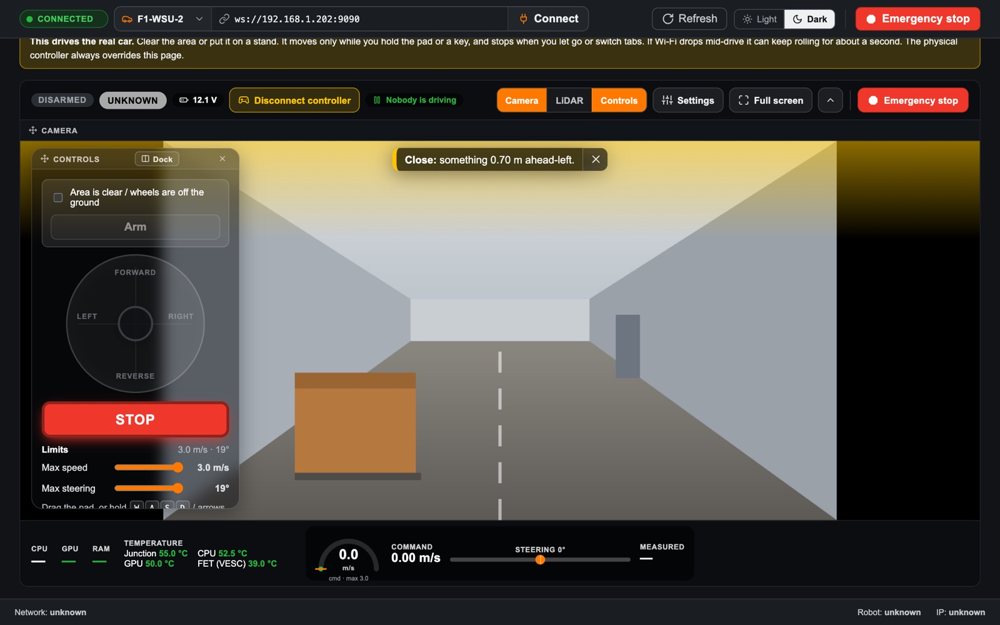

*The screenshots in this guide are from the real dashboard with a simulated
robot. The camera picture is a stand-in; on a car it is the car's own camera.*

.. contents:: Contents
   :local:
   :depth: 1

.. _drive-before-you-drive:

Before you drive
================

The yellow box at the top of the tab says it plainly: **this drives the real
car.**

- **Clear the area, or put the car on a stand** with its wheels off the ground.
- **Have someone hold the physical controller.** It is your backup stop, and it
  always wins over the dashboard (see :ref:`drive-who-is-in-charge`).
- **Check the top bar says CONNECTED** and the right car is picked (for example
  ``F1-WSU-2``).
- **Check the battery.** The top bar of the driving view shows the voltage; the
  Overview tab grades it.
- **Know where Emergency stop is**: the red button at the far right of every
  bar. It stops the car for everyone.

.. _drive-tour:

A tour of the screen
====================

The Drive tab *is* the driving view, embedded in the page. **Full screen**
makes the same view cover the whole screen; everything below works the same in
both.

The top bar
-----------

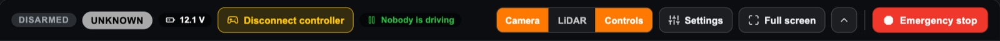

Status on the left, actions on the right, Emergency stop last and set apart so
it is always in the same corner.

.. list-table::
   :header-rows: 1
   :widths: 25 75

   * - Item
     - What it tells you or does
   * - **DISARMED / ARMED / DRIVING**
     - The state of the controls on this page. DRIVING means a command is going
       out right now
   * - **Health pill**
     - The overall verdict from the Overview tab (HEALTHY, DEGRADED, FAILED,
       UNKNOWN)
   * - **Battery**
     - The battery voltage from the motor controller (VESC)
   * - **Disconnect controller**
     - Shown while a physical controller is connected. Drops its Bluetooth
       link; press the PS button on the controller to reconnect. Refused while
       someone holds L1 or R1
   * - **Who is driving**
     - One answer: *Nobody is driving*, *You're armed*, *You are driving*,
       *The controller is driving*, *Someone else is driving*, *Autonomous code
       is driving*, or *Emergency stop is on*
   * - **Camera · LiDAR · Controls**
     - Which panes show. Orange means on
   * - **Settings**
     - Everything about how the view looks (see :ref:`drive-arranging`)
   * - **Full screen** / **Exit**
     - Cover the whole screen, or come back. Leaving full screen disarms
   * - **⌃**
     - Hide the top bar for more picture
   * - **Emergency stop**
     - Stops the car for everyone (see :ref:`drive-what-stops`)

A row of messages can appear under the bar: red alerts that must not be missed
(*Not connected*, *No data from the robot*, *Emergency stop is on*) and short
notes about what just happened (*Armed. Hold the pad or a drive key to move.*).

The picture and the controls
----------------------------

The camera fills the view. The **Controls** card floats over it as see-through
glass, bottom left by default: drag its title bar to move it anywhere,
**Dock** to make it a column beside the pictures, **×** to close it.

The bottom bar
--------------

The robot's computer on the left (CPU, GPU, RAM and temperatures, coloured by
how they grade), and the speed readout in the middle:

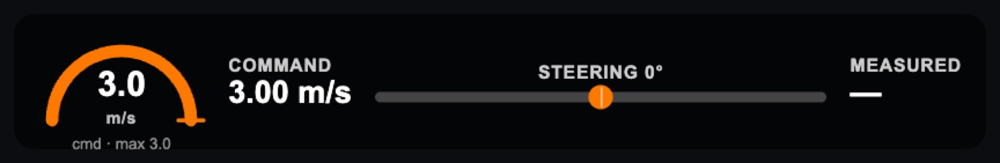

- **The speedometer arc** is the car's measured speed (from ``/odom``), or your
  command until the car reports one. The **orange tick** is what you are
  commanding. The scale ends at your max-speed limit, so a full arc means "at
  the limit". The arc turns orange near the limit and blue in reverse.
- **Command**: the speed being sent. **Measured**: what the car reports.
- **Steering**: the angle being sent, with a marker that slides left and right.

Speed can be shown in m/s, km/h or mph (Settings → Readouts).

.. _drive-step-by-step:

Driving, step by step
=====================

1. Arm
------

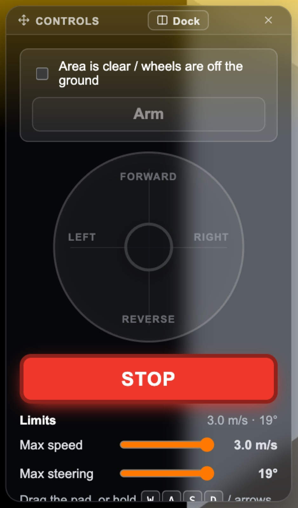

Tick **Area is clear / wheels are off the ground**, then press **Arm**. Arm
stays greyed out until the box is ticked, the page is connected, nobody else is
driving from another dashboard, and the emergency stop is off.

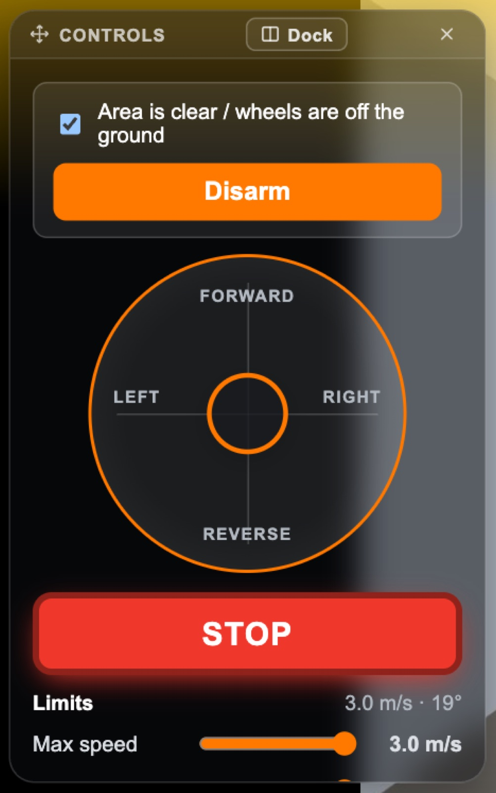

Armed, the button turns orange and reads **Disarm**, the pad lights up orange,
and the top bar shows **ARMED** and *You're armed*. Nothing moves yet.

2. Drive
--------

Pick whichever is easiest; they all do the same thing.

- **The pad**: press and drag the knob. Up is forward, down is reverse, left
  and right steer. How far you drag sets how fast and how hard.
- **The keyboard**: hold **W A S D** or the **arrow keys**.
- **On a phone**: the two thumb sticks (see :ref:`drive-phone`).

**The car only moves while you hold.** Let go and it stops at once: the page
sends a burst of zero-speed commands immediately, without ramping down.

Starting is ramped so the motor controller never gets a jump: about **0.6 s
from stop to the normal top speed of 3 m/s**, with steering following at a
matching pace. The page sends 20 commands a second while you hold.

3. Stop and disarm
------------------

Press **STOP**, or **Space**. Both stop the car and disarm. To drive again,
press Arm.

.. _drive-what-stops:

What stops the car
==================

The page stops and disarms by itself whenever it can no longer be sure you are
in control:

.. list-table::
   :header-rows: 1
   :widths: 50 50

   * - What happens
     - What the page does
   * - You let go of the pad, the sticks or the keys
     - Stops (stays armed)
   * - **STOP**, **Space**, or **Esc** on the Drive tab
     - Stops and disarms
   * - You untick the safety box
     - Disarms
   * - You switch to another tab, or leave full screen
     - Disarms
   * - The browser window loses focus, the page is hidden, or it closes
     - Disarms
   * - The connection to the robot drops or is replaced
     - Disarms
   * - The emergency stop comes on
     - Disarms, and Arm stays greyed out until it is released
   * - You open an unlock dialog, arrange the thumb sticks, or reset the view
       settings
     - Disarms
   * - On a phone: you close the controls, or turn the phone upright
     - Disarms (the sticks go with them)

**If Wi-Fi drops mid-drive**, no stop command can reach the car. The robot
catches that itself: when ``/drive`` goes quiet for **0.3 s** while the car was
moving, ``system_diagnostics.py`` on the robot sends zero speed. The car can
still roll for a moment, which is why the yellow box warns about it.

Emergency stop
--------------

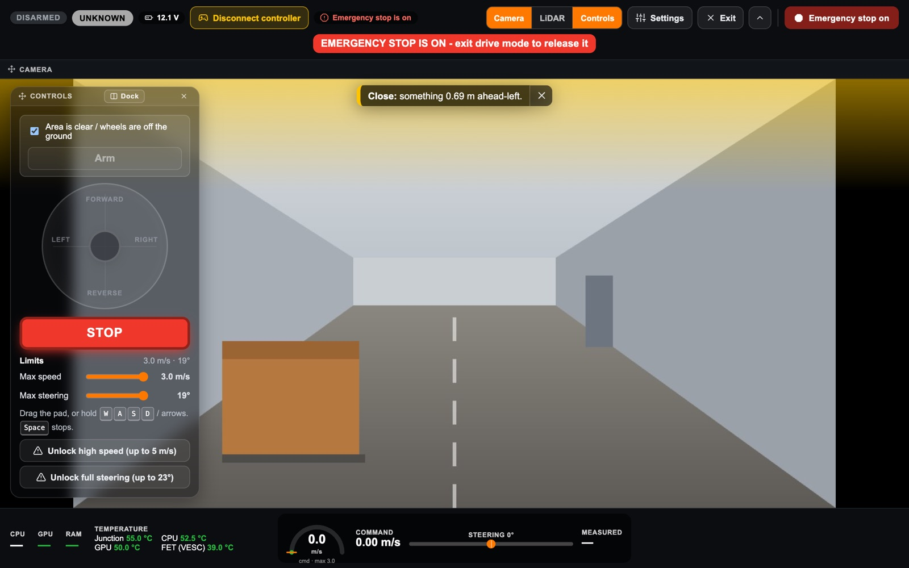

**Emergency stop** stops the car **for everyone**: this page, other dashboards,
the physical controller and any autonomous code. On the robot it freezes the
node that turns drive commands into motor commands, and holds the motor at
zero.

While it is on, the button turns dark red and reads **Emergency stop on**, a
red alert stays in view, and nobody can arm. To release it, leave full screen
and press **Allow driving again** on the red banner under the page's top bar.
It asks first, and it is refused while someone holds a deadman on the
controller.

The full story is in :doc:`../design/emergency-stop`.

.. _drive-who-is-in-charge:

Who is in charge
----------------

The physical controller always wins. If someone holds its deadman (L1 or R1),
the car follows the controller and ignores this page. *Who is driving* then
reads **The controller is driving**. If another dashboard or autonomous code is
sending commands, this page refuses to arm.

.. _drive-full-screen:

Full screen
===========

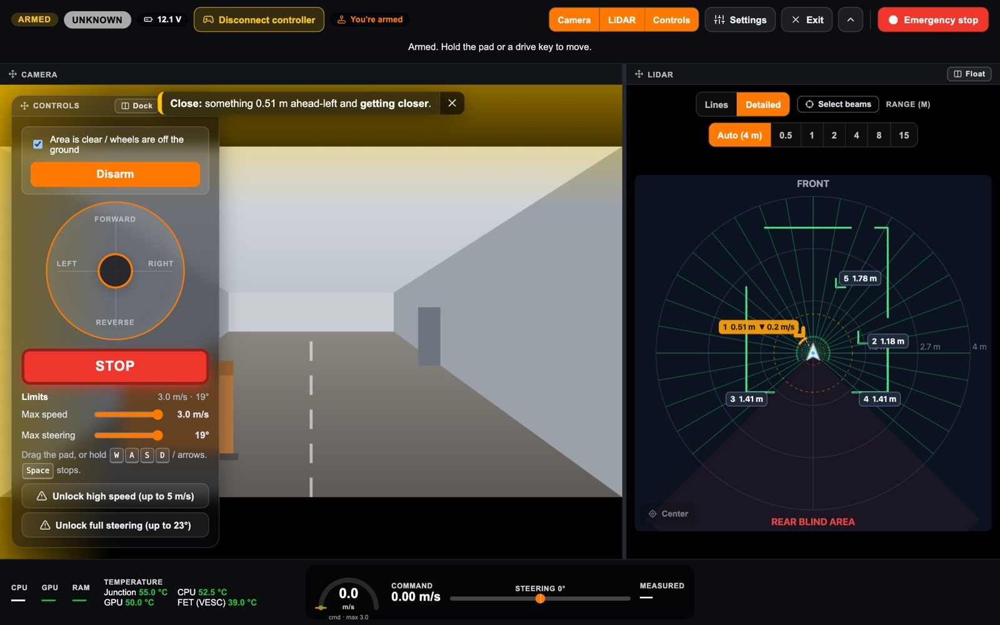

**Full screen** turns the same view into a first-person driving screen. Camera
and LiDAR can sit side by side; drag the divider between them to change the
split, or drag a pane's title onto another to swap them. **Exit** (or **Esc**)
comes back, and disarms.

The Overview tab's camera buttons open full screen directly, with just the
camera or the camera and LiDAR.

.. _drive-seeing-around:

Seeing what is around the car
=============================

The LiDAR pane
--------------

The LiDAR is a top-down map with the car in the middle, facing up. In the
**Detailed** view (as in the picture above) it is a radar:

- Every LiDAR return is a small green dot, and walls are drawn as connected
  outlines.
- The five nearest objects get a **numbered tag** with their distance. Anything
  closer than 1 m is outlined in amber, closer than 0.3 m in red.
- Something getting closer shows **▼ and its speed** on its tag.
- A dashed line runs to the nearest thing, dashed circles mark 0.3 m and 1 m,
  and a ring around the car is coloured by each direction's status.
- **Point at the map** for details: an object's distance, direction, width and
  whether it is approaching; or, over empty space, how far and in which
  direction that spot is.

**Lines** is the simpler view: one green outline of everything the LiDAR sees.
Zoom with the range buttons or the scroll wheel, drag to look around, and press
**Center** to bring the car back to the middle.

LiDAR over the camera
---------------------

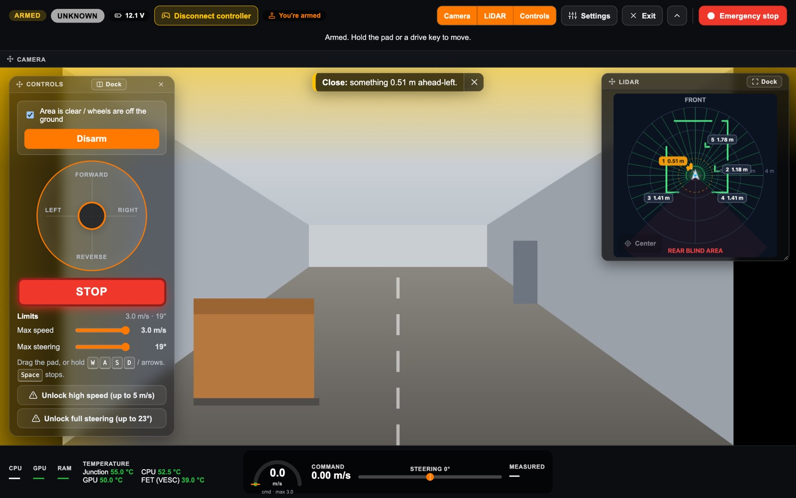

**Float** on the LiDAR pane's title turns it into a small window over the
camera. Drag its title to move it, drag its corner to resize it, and press
**Dock** to put it back beside the camera.

Warnings on the picture
-----------------------

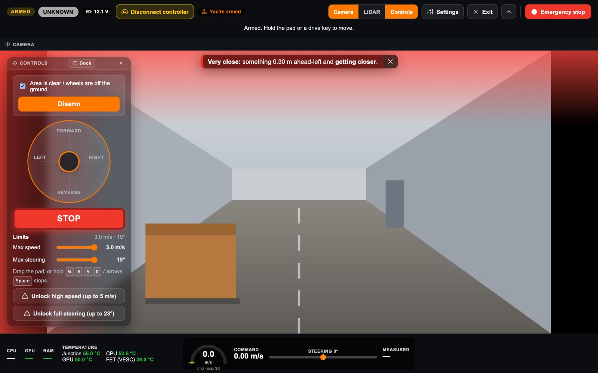

- **Edge warning lights.** The edge of the picture facing an obstacle glows
  **amber within 1 m** and **pulses red within 0.5 m**, like a car's parking
  sensors: the top edge for ahead, the sides for left and right.
- **The close-object warning.** A sentence on the picture: *Close: something
  0.70 m ahead-left*, or *Very close: … and getting closer*. Drag it anywhere.
  **×** hides it; Settings → *Close-object warning* brings it back.
- **On a phone**, it also buzzes once the moment something comes within 0.5 m
  while you are armed (if the phone supports it).

.. _drive-arranging:

Arranging the view
==================

Settings
--------

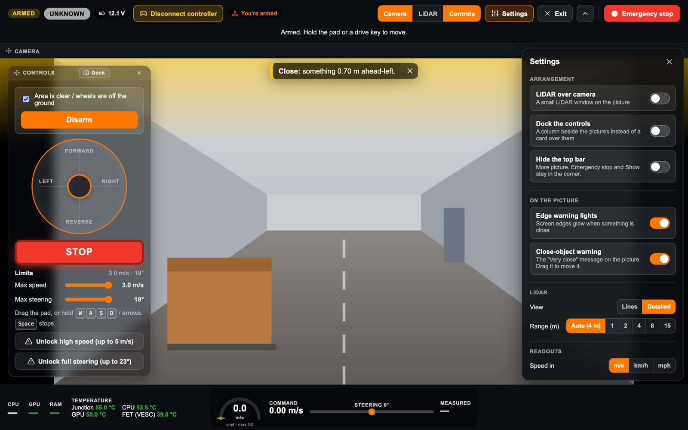

**Settings** holds everything about how the view looks. It closes with **×**, a
click anywhere else, or **Esc**. All of it is remembered in your browser.

.. list-table::
   :header-rows: 1
   :widths: 25 75

   * - Section
     - Options
   * - **Arrangement**
     - LiDAR over camera · Dock the controls · Hide the top bar · *Controls
       only* (phones)
   * - **On the picture**
     - Edge warning lights · Close-object warning
   * - **LiDAR**
     - Lines or Detailed · range
   * - **Readouts**
     - Speed in m/s, km/h or mph
   * - **Screen**
     - Keep the screen awake · Buzz when very close (phones)
   * - **Keyboard**
     - The keys, as a reminder (desktop)
   * - **Thumb sticks**
     - Move sticks & STOP (phones)
   * - **Camera**
     - Reconnect camera
   * -
     - **Reset all view settings**: every layout, position and switch back to
       its default

Docked controls
---------------

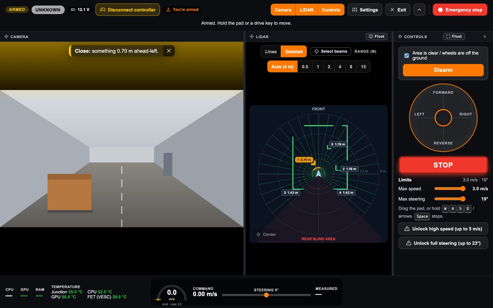

If you would rather the controls never cover the picture, **Dock** them (on the
card's title, or in Settings). They become a column beside the camera and
LiDAR, with a divider you can drag. **Float** turns them back into a card.

Driving with the controls closed
--------------------------------

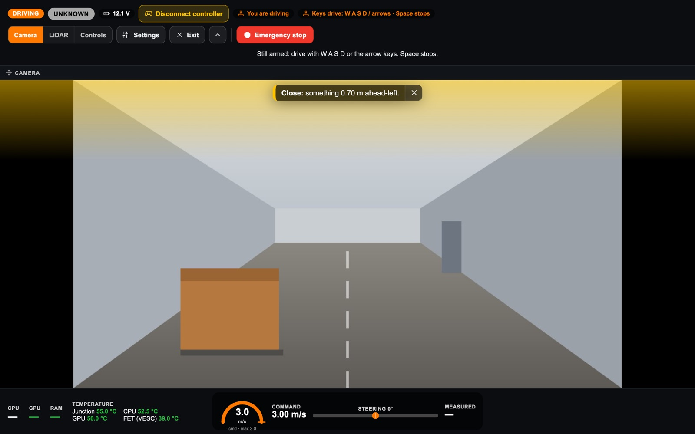

On a computer, closing the Controls card (its **×**, or **Controls** in the top
bar) **does not disarm**. The keys still drive, and an orange chip in the top
bar says so: *Keys drive: W A S D / arrows · Space stops*. This gives you the
whole picture while you drive.

Hiding the top bar
------------------

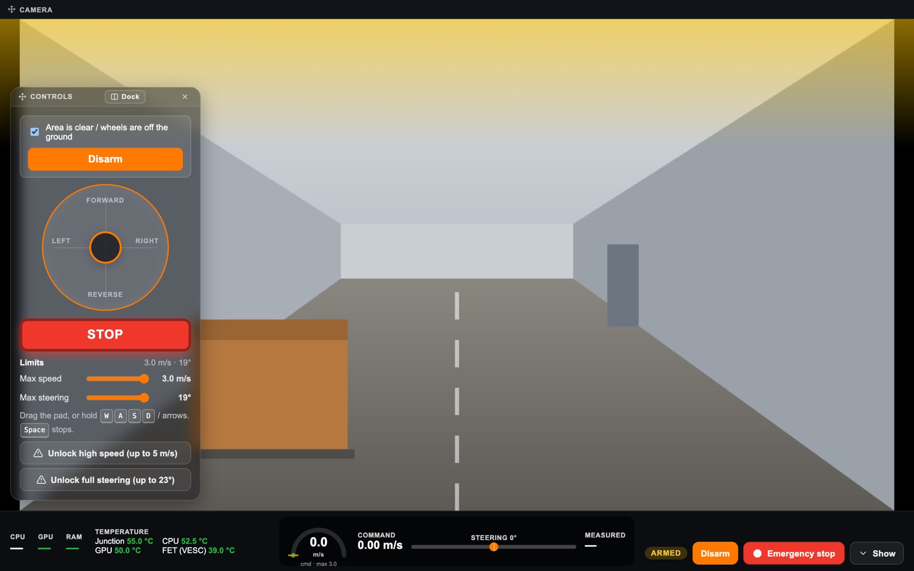

**⌃** in the top bar (or Settings → *Hide the top bar*) tucks the bar away. A
small cluster stays in the corner with what must never be out of reach: the
**ARMED** state, **Disarm**, **Emergency stop**, any red alert, and **Show** to
bring the bar back.

.. _drive-limits:

Speed and steering limits
=========================

The Limits section of the Controls card is always in view.

- **Max speed** and **Max steering** sliders cap what the pad, keys and sticks
  can ask for. The normal limits are **3 m/s and 19°**, the same as the stock
  controller.
- **Unlock high speed (up to 5 m/s)** and **Unlock full steering (up to 23°)**
  raise the caps. Each opens a warning that spells out the risk and needs two
  boxes ticked:

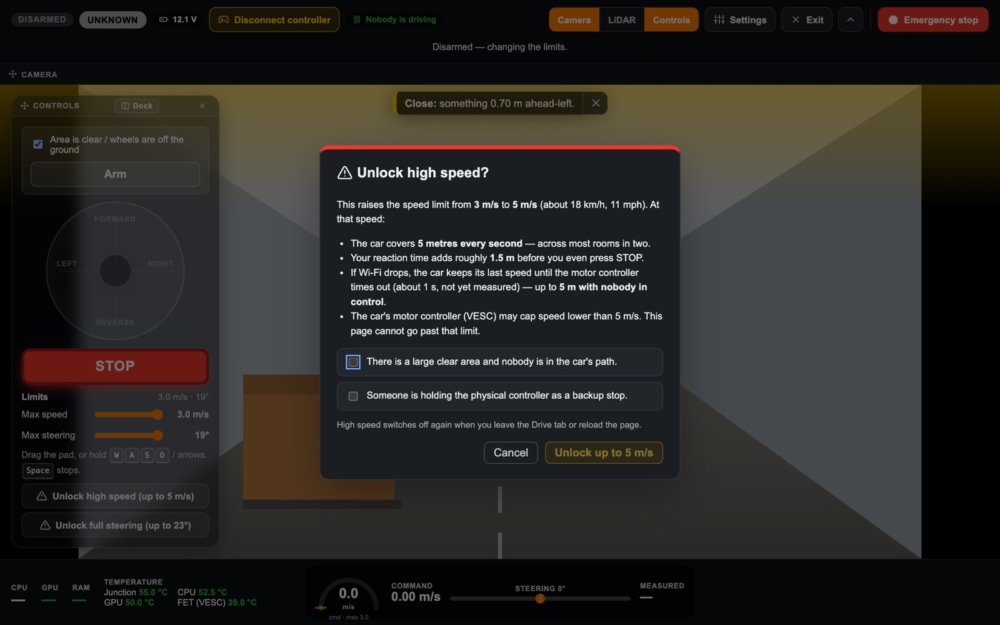

Opening a warning disarms. An unlock lasts until you leave the Drive tab or
reload the page; it never carries over. The motor controller (VESC) may cap
speed or steering lower than these, and the page cannot go past that.

.. _drive-phone:

On a phone
==========

Driving with thumbs needs the whole screen and the phone held sideways, so on a
phone the Drive tab shows the pictures, and **Controls** takes you to full
screen to drive.

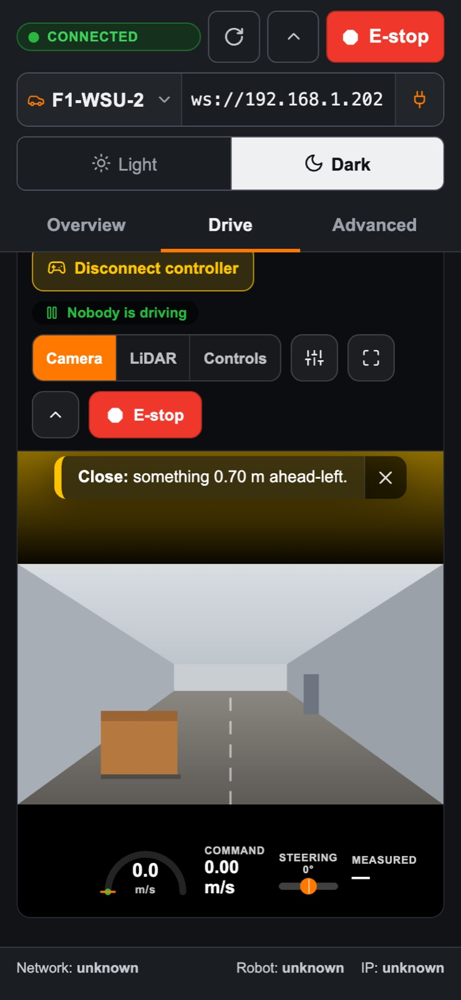

Held upright, full screen asks you to turn the phone:

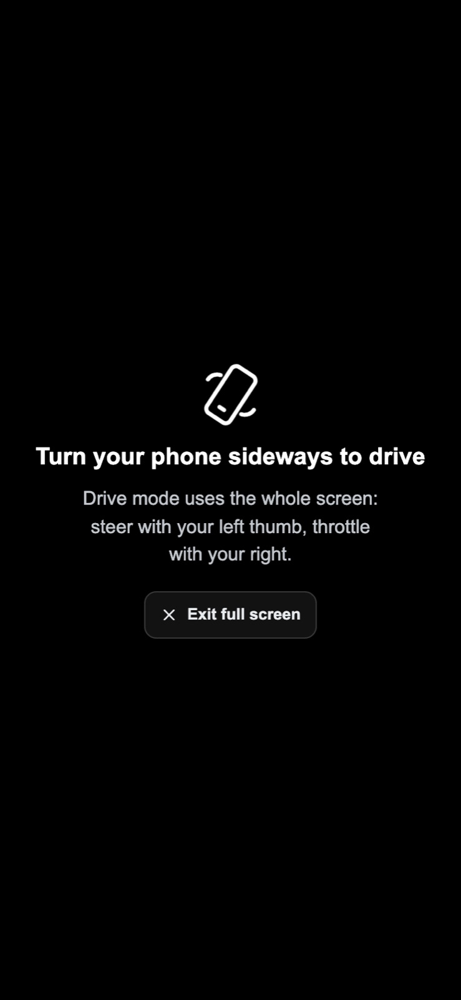

Sideways, it is laid out like a game:

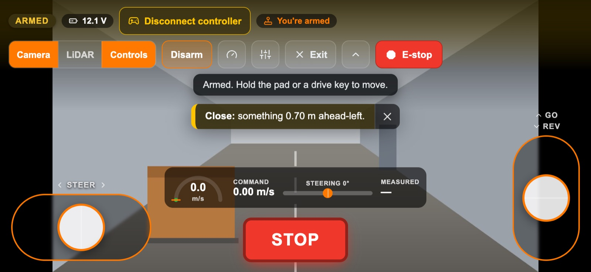

- **Left thumb steers** (drag left or right). **Right thumb is the throttle**
  (up to go, down to reverse). Use both at once.
- **STOP** is in the middle. **E-stop** is in the top bar.
- **Arm** is in the top bar. The **gauge** button opens the safety box and the
  limits:

  .. image:: images/drive-tab/16-phone-limits-drawer.jpg
     :alt: The limits drawer on a phone

- The **sliders** button opens Settings. **⌃** hides the top bar.
- **Controls only** (Settings) hides everything but the sticks and STOP; the
  corner keeps ARMED, Disarm, E-stop and Show:

  .. image:: images/drive-tab/17-phone-controls-only.jpg
     :alt: Controls only on a phone

- **Move sticks & STOP** (Settings → Thumb sticks) lets you drag them to where
  your thumbs reach. Driving is off while you arrange; **Done** finishes,
  **Reset** puts them back:

  .. image:: images/drive-tab/18-phone-arrange.jpg
     :alt: Arranging the thumb sticks

The phone keeps its screen awake while the view is open, so it does not lock
mid-drive. On iPhones a web page cannot go truly full screen or lock the
rotation, so the view fills the browser window instead.

.. _drive-keyboard:

Keyboard
========

.. list-table::
   :header-rows: 1
   :widths: 25 75

   * - Key
     - What it does
   * - **W A S D** or **arrows**
     - Drive, while armed and held
   * - **Space**
     - Stop and disarm
   * - **Esc**
     - On the Drive tab: stop and disarm. In full screen: close Settings, or
       finish arranging, or leave full screen

The keys drive even with the Controls card closed. They do nothing while you
are typing in a box.

.. _drive-troubleshooting:

Troubleshooting
===============

**Arm stays greyed out.** Check, in order: the safety box is ticked; the top
bar says CONNECTED; *Who is driving* does not say someone else is driving; the
emergency stop is off.

**I am armed but the car does not move.** You have to hold the pad, a key or a
stick: arming alone sends nothing. If *Who is driving* reads *The controller is
driving*, someone is holding the controller's deadman and it overrides this
page. If the speedometer shows a command but *Measured* stays at zero, the
commands are not reaching the motor: see
:ref:`design/dashboard-drive-control troubleshooting
<dashboard-drive-control-troubleshooting>`.

**It disarmed by itself.** The note under the top bar says why (*window lost
focus*, *connection lost or replaced*, *left the Drive tab*, …). See
:ref:`drive-what-stops`.

**The camera is black or behind.** The camera connects on its own when the
robot does. **Reconnect camera** (Settings → Camera) retries. On a weak Wi-Fi
link the picture drops frames rather than falling behind; if it is choppy, move
closer to the router.

**The controls are in the way.** Drag the card by its title, Dock it, or close
it and drive with the keys.

**The view looks wrong after rearranging.** Settings → **Reset all view
settings**.

**Nothing is Responding, All Nodes are down.** Likely Cause: Faulty Battery
**Replace Battery**

.. _drive-how-command-reaches:

How a command reaches the car
=============================

.. mermaid::

   flowchart LR
     you["You: pad, keys or thumb sticks"] --> page["Dashboard page drive.js, 20 commands/s while you hold"]
     page -- "/drive over Wi-Fi (rosbridge, port 9090)" --> mux["ackermann_mux physical controller has priority"]
     pad["Physical controller deadman L1 / R1"] --> mux
     mux --> a2v["ackermann_to_vesc"] --> vesc["VESC motor controller"] --> motor(("Motor and steering"))
     wd["Robot watchdog system_diagnostics.py"] -. "zero speed if /drive goes quiet 0.3 s" .-> mux
     es["Emergency stop"] -. "freezes it, holds the motor at 0" .-> a2v

The page publishes ``ackermann_msgs/AckermannDriveStamped`` on ``/drive``, the
mux's navigation input, over the same rosbridge connection the rest of the
dashboard uses. The details, every safety rule and the code map are in
:doc:`../design/dashboard-drive-control`.