=====================================
The Overview tab: a user guide
=====================================

How to read the dashboard's first page: whether the car is ready to drive, what
each card measures, what the colours mean, and where to look when something is
wrong.

This guide is for **anyone using the cars**: students before a lab, instructors
setting cars up, developers checking a car before a test. It explains what you
see. The Advanced tab has the detail behind it (:doc:`advanced-tab`), and
driving is in :doc:`drive-tab`.

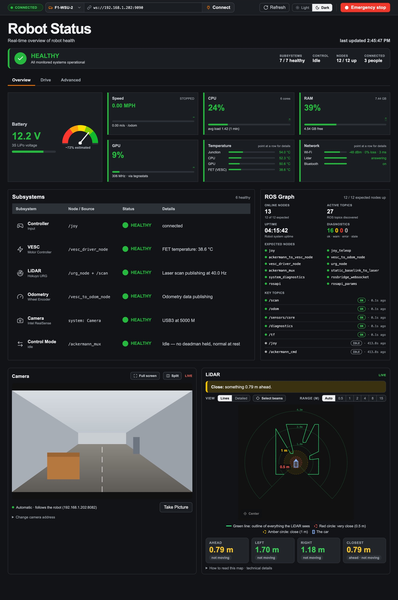

*The screenshots in this guide are from the real dashboard with a simulated
robot. The camera picture is a stand-in; on a car it is the car's own camera.*

.. contents:: Contents
   :local:
   :depth: 1

.. _overview-10-second-check:

The 10-second check
===================

Before you drive, look at three things, top to bottom:

1. **The banner says HEALTHY** (green tick). Anything else names what is wrong.
2. **The battery is green**: 11.6 V or more.
3. **The LiDAR and camera say LIVE**, and the LiDAR map shows the room around
   the car.

If all three hold, the car is ready. Everything else on the page is there to
explain a problem when one of them doesn't.

.. _overview-connecting:

Connecting to a car
===================

The top bar is on every tab.

.. list-table::
   :header-rows: 1
   :widths: 22 78

   * - Item
     - What it does
   * - **Connection pill**
     - **CONNECTED** (green), **CONNECTING...**, or **DISCONNECTED** (red)
   * - **Robot list**
     - Pick a car by name, **F1-WSU-1** to **F1-WSU-12**. Picking one fills in
       its address and connects. **Other…** is for anything else
   * - **Address**
     - The car's rosbridge address, ``ws://192.168.1.201:9090`` to
       ``ws://192.168.1.212:9090``. You can edit it, then press Enter or
       **Connect**
   * - **Refresh**
     - Reconnects and re-reads the list of ROS nodes and topics straight away
       (normally every 5 s)
   * - **Light / Dark**
     - The colour theme. Your choice is remembered in this browser; with none,
       the page follows your computer's setting
   * - **Emergency stop**
     - Stops the car for everyone. See :doc:`../design/emergency-stop`

When the page is opened from a car
(``http://192.168.1.202:8000/dashboard.html``), it connects to that car on its
own. Opened from anywhere else, it connects to the address in the link:
``dashboard.html?url=ws://192.168.1.202:9090``.

Links can open a tab directly: ``dashboard.html#drive``,
``dashboard.html#advanced``.

.. _overview-status-banner:

The status banner
=================

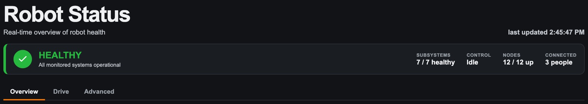

The banner answers one question: **can I drive?** It shows the *worst* state of
any subsystem, and names the ones that are not healthy.

.. list-table::
   :header-rows: 1
   :widths: 25 75

   * - Banner
     - Meaning
   * - **HEALTHY** (green tick)
     - *All monitored systems operational*
   * - **DEGRADED** (amber !)
     - Something works but needs attention, for example *2 subsystems
       degraded — LiDAR, Battery*
   * - **FAILED** (red !)
     - Something the car needs is not working, for example *1 critical
       subsystem — Odometry*
   * - **UNKNOWN** (grey ?)
     - Something has not reported yet. Unknown means "cannot tell yet", not
       "failed"
   * - **NOT CONNECTED** (grey power icon)
     - The page cannot reach the car at all, so it says nothing about the car's
       health. The line below says why, and how to fix it

On the right of the banner:

.. list-table::
   :header-rows: 1
   :widths: 22 78

   * - Fact
     - What it shows
   * - **Subsystems**
     - How many of the 7 subsystems are healthy
   * - **Control**
     - Who the motor mux is listening to: **Idle** (no one, normal at rest),
       **Joystick**, or **Navigation / web** (autonomous code or a dashboard)
   * - **Nodes**
     - How many of the 12 expected ROS nodes are running
   * - **Connected**
     - How many people have the dashboard open: *Just you*, *3 people*. Turns
       amber at 8 and red over 10 (see :ref:`overview-too-many-people`)

**Last updated** (top right) is the last time the page heard from the car.

The **Advanced** tab shows a red number when the car's own checks report
warnings or errors that the Overview does not show in detail.

.. _overview-battery-computer:

Battery and the computer
========================

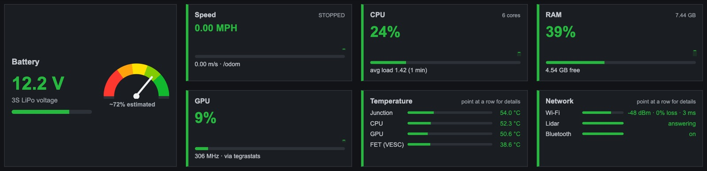

Battery
-------

The voltage of the 3-cell LiPo pack, from the motor controller (VESC).

.. list-table::
   :header-rows: 1
   :widths: 25 20 55

   * - Voltage
     - Colour
     - What to do
   * - **11.6 V or more**
     - Green
     - Nothing
   * - **11.1 to 11.6 V**
     - Amber, *Low - get a spare pack ready*
     - Finish what you are doing; the pack still runs fine
   * - **Below 11.1 V**
     - Red, *Replace the pack soon*
     - Swap the pack. Below about 10 V the voltage falls off a cliff

The voltage dips by 0.1 to 0.2 V the moment the motor pulls, so the page shows
the **middle value of the last 5 seconds**, not each reading. The
**percentage** is a rough estimate on a straight line from 11.1 V (0 %) to
12.6 V (100 %).

These lines were agreed with the course instructor; the reasoning is in
:doc:`../meetings/instructor-interview`.

The tiles
---------

Each tile's **coloured left edge** is its grade: green fine, amber watch it,
red act now, grey no data. The faint line in the corner is the last 60 seconds.

.. list-table::
   :header-rows: 1
   :widths: 14 40 23 23

   * - Tile
     - What it shows
     - Amber
     - Red
   * - **Speed**
     - The car's speed from its wheel odometry, in MPH and m/s, and FORWARD,
       REVERSE or STOPPED. The bar is full at 3 m/s
     -
     - No odometry for 2 s (STALE)
   * - **CPU**
     - How busy the robot's processor is, and its 1-minute load average
     - Load above 1 per core
     - Load above 2 per core
   * - **RAM**
     - Memory in use, and how much is free
     - Less than 20 % free
     - Less than 10 % free
   * - **GPU**
     - How busy the graphics processor is
     - 95 % or more for 5 s
     - Never: a busy GPU is a heavy job, not a fault
   * - **Temperature**
     - The Jetson's junction (hottest point), CPU and GPU, and the VESC's power
       transistors (FET)
     - Jetson 70 °C, FET 65 °C
     - Jetson 85 °C, FET 80 °C
   * - **Network**
     - The robot's Wi-Fi, the LiDAR's cable, and Bluetooth
     - See below
     - See below

**Speed says UNKNOWN after a fresh start.** The odometry node sends nothing
until it has seen one steering command, so a car that has just been switched on
has no speed reading yet. The tile says *starts after the first steering
command*; that is normal.

**Network** has a row each for:

- **Wi-Fi**: signal, packet loss and round trip to the router. Good is -67 dBm
  or better, under 1 % loss and under 30 ms. Red is below -75 dBm, 5 % loss or
  more, or over 100 ms.
- **Lidar**: *answering*, *no reply* (the cable is in but the LiDAR doesn't
  answer: check its power), or *unplugged*.
- **Bluetooth**: has to be *on* for the PS4 controller to connect.

Details on hover
----------------

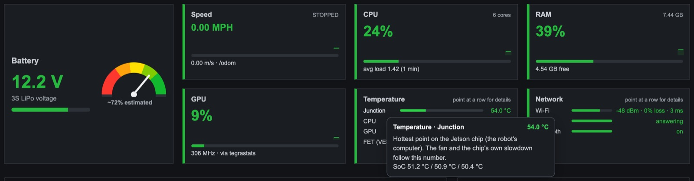

The Temperature and Network tiles say *point at a row for details* (*tap a row*
on a phone). Each row explains what it measures and where the lines are.

.. _overview-subsystems-graph:

Subsystems and the ROS graph
============================

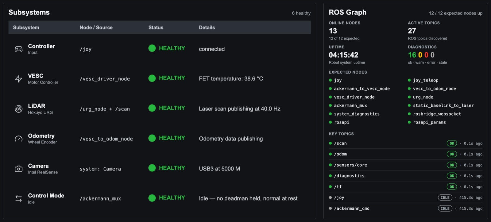

Subsystems
----------

One row per part of the car, **problems first**. The **Details** column says
what is wrong in words, and often how to fix it.

.. list-table::
   :header-rows: 1
   :widths: 18 38 44

   * - Subsystem
     - Healthy when
     - Not healthy when
   * - **Controller**
     - The PS4 controller is connected, or no controller is connected (that is
       normal, not a fault)
     - ROS cannot read a connected controller
   * - **VESC** (motor controller)
     - The VESC driver is running with no fault code
     - FET at 65 °C (degraded) or 80 °C (failed); any VESC fault; driver not
       running
   * - **LiDAR**
     - Scans arrive at 38 to 42 Hz
     - Rate outside that (degraded); no scans, or two drivers fighting over the
       LiDAR (failed)
   * - **Odometry**
     - Odometry is publishing, or is waiting for the first steering command
       (normal at rest)
     - Node not running, or it stopped sending
   * - **Camera**
     - The RealSense is on USB 3 and streaming at about 30 fps
     - Under 15 fps or on USB 2 (degraded); no frame for 3 s, or not found
       (failed)
   * - **Control Mode**
     - The mux is idle, on the joystick, or on navigation
     - ``ackermann_mux`` is not running

The banner counts **7** subsystems; the table shows 6, because **Battery** has
its own card above.

When something fails, the details say how to fix it. For example, when the
LiDAR answers ping but sends no scans: *an old urg_node may hold its only
connection. Stop bringup, run pkill -f urg_node_driver, then start bringup
again.*

The full list of subsystems and what "healthy" means for each is in
:doc:`../design/subsystem-inventory`.

ROS Graph
---------

What is running on the car's ROS side:

- **Online nodes**: every ROS node running, and how many of the 12 expected
  ones are among them.
- **Active topics**: every topic in the ROS graph.
- **Uptime**: how long the robot's computer has been on. If it goes backwards
  the board rebooted, which on these cars usually means the battery.
- **Diagnostics**: the car's own checks, counted as **ok · warn · error ·
  stale**.
- **Expected nodes**: the 12 nodes bringup should start. A red dot means not
  running.
- **Key topics**: the 7 the car cannot drive without, with their state and the
  age of the last message. **IDLE** on ``/joy`` and ``/ackermann_cmd`` is
  normal when nobody is driving. The states are explained in the
  :ref:`Advanced guide <advanced-topics>`.

.. _overview-camera:

Camera
======

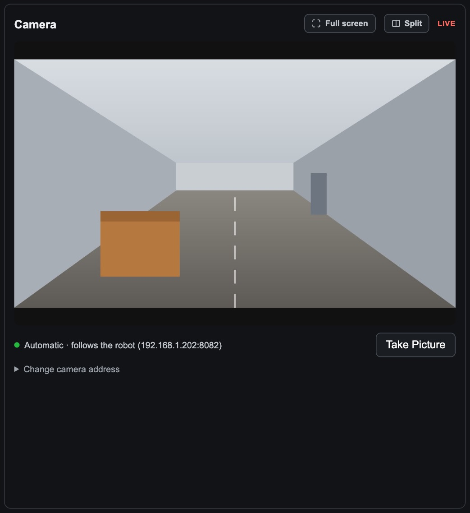

The live picture from the car's camera. **It connects on its own** whenever the
page connects to a car: the line under the picture says *Automatic · follows
the robot* and the address it uses.

- **Full screen** opens the camera full screen; **Split** opens the camera and
  LiDAR side by side. Both are the :ref:`driving view <drive-full-screen>`.
- **LIVE** in the corner means pictures are arriving. *no stream* means none
  are.
- **Take Picture** freezes the current frame below the stream. **Save PNG**
  downloads it.

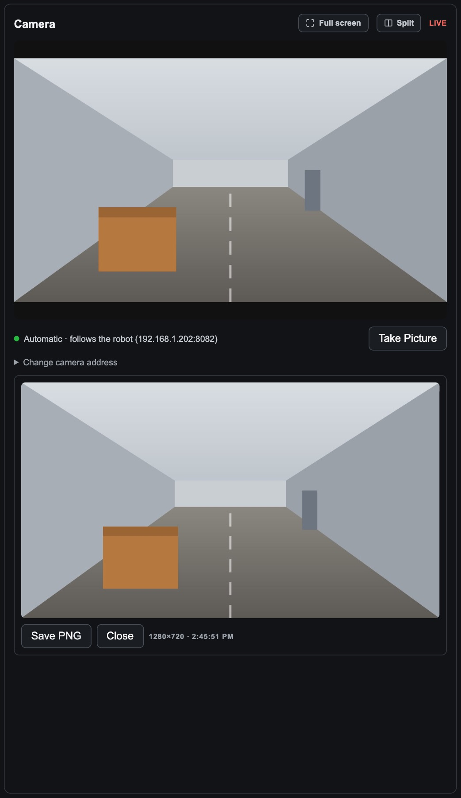

- **Change camera address** is for an unusual setup (a camera on another
  machine). After changing it, **Use automatic** goes back to following the
  car. A link can set it too: ``dashboard.html?video=http://…``.

The camera stream comes from ``camera_http.py`` on the car, on port 8082. On a
weak Wi-Fi link it drops frames rather than falling behind, so the picture is
choppy but current.

.. _overview-lidar:

LiDAR
=====

A top-down map of what the LiDAR sees. **The car is in the middle, facing up.**
The line at the top describes the closest thing in words, for example *Close:
something 0.79 m ahead.*

- **Drag** to look around, **scroll** to zoom, **double-click** to reset.
  **Center** puts the car back in the middle.
- **Range** sets how far the map reaches: **Auto** (follows the room), or 0.5
  to 15 m.
- **Point at the map** for the distance and direction of a beam or an object.

Lines
-----

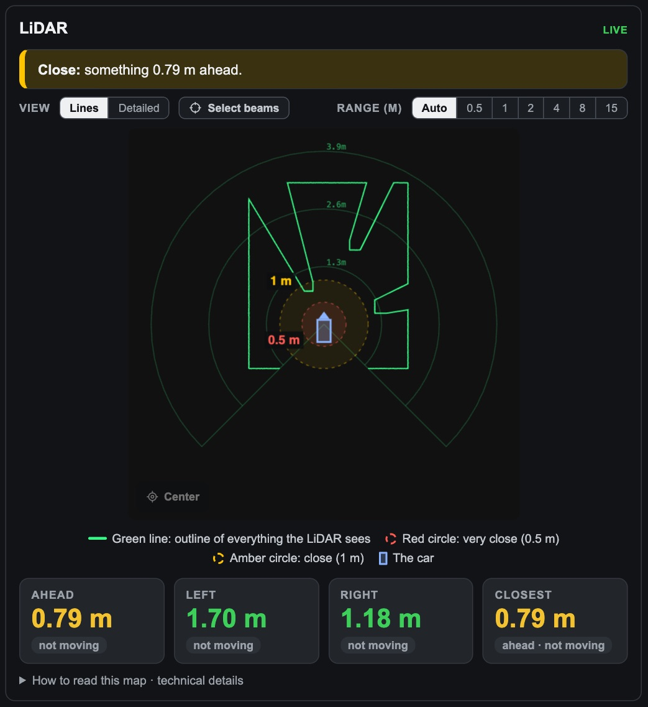

The simple view: one green outline of everything the LiDAR sees, an **amber
circle at 1 m** and a **red circle at 0.5 m**. Under the map, the closest
distance **ahead**, **left**, **right** and overall, each marked *▼ getting
closer*, *▲ moving away* or *not moving* over the last second.

Detailed
--------

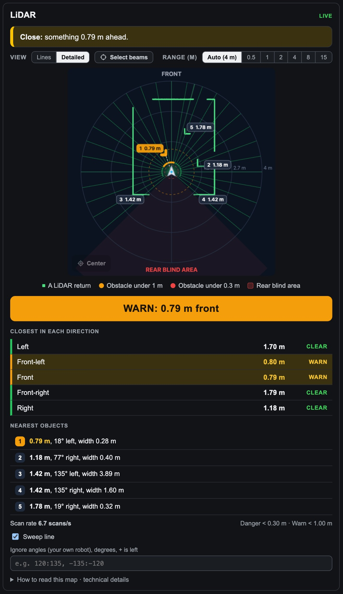

The radar view, for seeing exactly what is close:

- Every return is a green dot, and walls are drawn as connected outlines. The
  shaded wedge behind the car is the **rear blind area** the LiDAR cannot see.
- The five nearest objects get **numbered tags**. Closer than 1 m is amber
  (**WARN**), closer than 0.3 m is red (**DANGER**).
- The banner below gives the worst one: *WARN: 0.79 m front*.
- **Closest in each direction**: left, front-left, front, front-right and
  right, each CLEAR, WARN or DANGER.
- **Nearest objects**: distance, direction and width, and whether it is
  approaching.
- **Sweep line** turns the radar sweep on or off.
- **Ignore angles** hides parts of your own robot the LiDAR sees, as degrees
  with + to the left, for example ``120:135, -135:-120``.

Your choice of view is remembered in this browser.

Select beams (for your own code)
--------------------------------

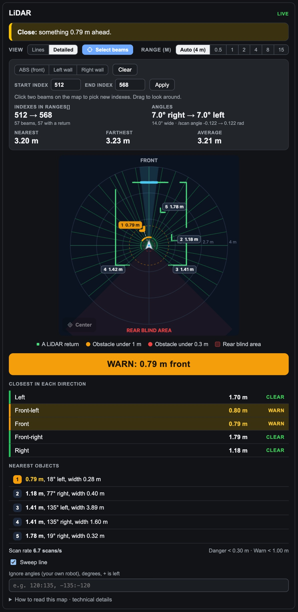

When you write code that reads ``/scan``, you need the **indexes** in
``ranges[]`` for the directions you care about. **Select beams** finds them:

- **ABS (front)**, **Left wall** and **Right wall** pick a narrow cone (±7°)
  straight ahead, to the left or to the right.
- Or **click two beams on the map**: one for the start, one for the end.
  **Esc** cancels.
- Or type a **Start index** and **End index** and press **Apply**.

The panel then shows the indexes (both ends included), the angles in degrees
and radians, and the nearest, farthest and average distance in that range. With
the selection above, your code would read ``msg.ranges[512:569]`` in Python.

.. _overview-footer:

The footer
==========

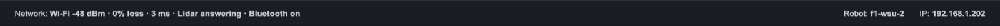

- **Network**: the same rows as the Network tile, in one line.
- **Robot**: the car's name, as its own computer reports it (``f1-wsu-2``). It
  always shows the car you are connected to, never a stale name.
- **IP**: the address the page was opened from.

.. _overview-something-wrong:

When something is wrong
=======================

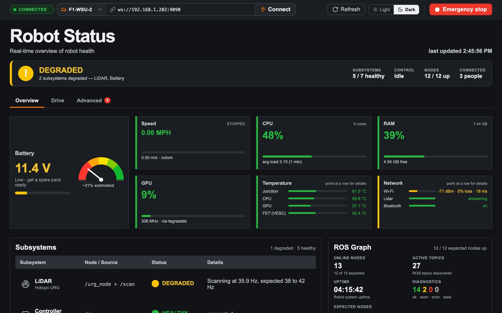

Here the banner says **DEGRADED — LiDAR, Battery**: the battery is at 11.4 V
(amber), the LiDAR is scanning at 35.9 Hz instead of 38 to 42, and the Wi-Fi
signal is weak (-71 dBm, the amber Network tile). The **Advanced 2** badge says
the car's own checks have two warnings; the :ref:`Advanced tab
<advanced-needs-attention>` lists them with details.

A good order to work through a problem:

1. **Read the banner's second line.** It names what is wrong.
2. **Read the Details column** in Subsystems. It often says how to fix it.
3. **Open the Advanced tab.** *Needs attention* lists every warning, worst
   first, each with a link to its detail.

Not connected
-------------

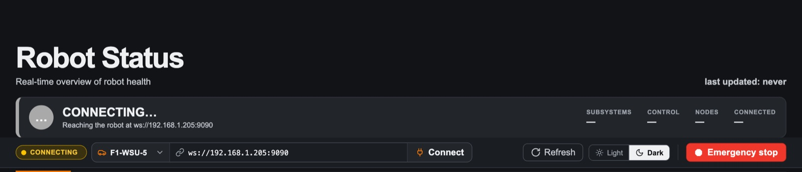

The page cannot reach the car's rosbridge. The banner says what it tried and
what to do. Check, in order:

- **The car is on, and you are on the same Wi-Fi.**
- **The right car is picked**, and the address is right.
- **The dashboard services are running on the car**:
  ``~/diag/start_diagnostics.sh``.

NO DATA FROM THE ROBOT
----------------------

A red strip under the header: the connection is open but nothing has arrived
for 4 seconds. The car may have lost Wi-Fi, or its rosbridge may be stuck. The
page may be showing old numbers until it clears.

.. _overview-too-many-people:

Too many people connected
-------------------------

The car's rosbridge serves **10 browser connections at once**; the 11th gets
nothing. Two amber strips warn about it:

- *rosbridge is answering but sending no topic data — this page is probably
  past its client limit (10). Close another dashboard tab.* **This page** is the
  one getting nothing: every topic looks silent, as if the car were dead. It
  isn't.
- *11 clients connected, rosbridge serves 10 — some dashboards are receiving
  nothing.* **Someone** is getting nothing, maybe not you.

Close dashboard tabs you are not using, on every computer and phone.

.. _overview-phone-light:

On a phone, and light mode
==========================

.. list-table::
   :widths: 50 50

   * - .. image:: images/overview-tab/16-phone.jpg
          :alt: The Overview on a phone
     - .. image:: images/overview-tab/17-phone-subsystems.jpg
          :alt: Subsystems on a phone

On a phone the page is one column. The **⌃** button in the top bar hides the
connection settings to leave more room, and the subsystems become one card
each.

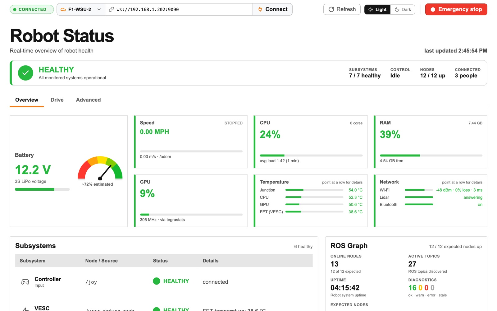

**Light** in the top bar switches to light mode, which is easier to read in a
bright lab.

.. _overview-numbers-from:

Where the numbers come from
===========================

Everything on the page arrives over one connection: rosbridge on the car, port
9090. The camera is the one exception, on port 8082.

.. mermaid::

   flowchart LR
     subgraph car["On the car"]
       sd["system_diagnostics.py CPU, RAM, GPU, temps, Wi-Fi, USB devices, clock"]
       vesc["vesc_driver_node battery, VESC faults"]
       urg["urg_node LiDAR scans"]
       odom["vesc_to_odom_node speed"]
       mux["ackermann_mux who is in control"]
       rosapi["rosapi list of nodes and topics"]
       rb["rosbridge port 9090"]
       cam["camera_http.py port 8082"]
       sd -- "/diagnostics" --> rb
       vesc -- "/sensors/core" --> rb
       urg -- "/scan" --> rb
       odom -- "/odom" --> rb
       mux -- "/diagnostics" --> rb
       rosapi --> rb
     end
     rb -- "WebSocket" --> page["Dashboard page grades every reading"]
     cam -- "MJPEG" --> page

- **Graded on the car** by ``system_diagnostics.py``: CPU, RAM, GPU,
  temperatures, storage, clock, camera USB speed and the controller. The page
  shows its verdict.
- **Graded in the page**: the battery, the VESC FET temperature, Wi-Fi quality,
  the camera frame rate, and every topic and subsystem.

To change a line, see :doc:`../system-overview`; every setting on the page side
is in ``prototype/js/config.js``.

.. _overview-thresholds:

Every threshold in one table
============================

.. list-table::
   :header-rows: 1
   :widths: 20 16 16 48

   * - What
     - Amber
     - Red
     - Where it is set
   * - Battery
     - below 11.6 V
     - below 11.1 V
     - ``config.js`` (``BATT_WARN``, ``BATT_ERR``)
   * - Jetson temperature
     - 70 °C
     - 85 °C
     - ``system_diagnostics.py`` (``TJ_WARN``, ``TJ_ERR``)
   * - VESC FET temperature
     - 65 °C
     - 80 °C
     - ``config.js`` (``FET_WARN``, ``FET_ERR``)
   * - CPU load average
     - above 1 per core
     - above 2 per core
     - ``system_diagnostics.py`` (``cpu()``)
   * - Free memory
     - below 20 %
     - below 10 %
     - ``system_diagnostics.py`` (``MEM_WARN``, ``MEM_ERR``)
   * - GPU
     - 95 % for 5 s
     - never
     - ``system_diagnostics.py`` (``GPU_WARN``)
   * - Disk used
     - 85 %
     - 95 %
     - ``system_diagnostics.py`` (``DISK_WARN``, ``DISK_ERR``)
   * - Wi-Fi signal
     - below -67 dBm
     - below -75 dBm
     - ``config.js`` (``WIFI_SIGNAL_*``)
   * - Wi-Fi packet loss
     - 1 %
     - 5 %
     - ``config.js`` (``WIFI_LOSS_*``)
   * - Wi-Fi round trip
     - 30 ms
     - 100 ms
     - ``config.js`` (``WIFI_RTT_*``)
   * - Camera
     - under 15 fps
     - no frame for 3 s
     - ``config.js`` (``CAMERA_*``)
   * - LiDAR scan rate
     - outside 38–42 Hz
     - no scans
     - the LiDAR driver's own settings
   * - Speed reading
     -
     - no odometry for 2 s
     - ``metrics.js``
   * - LiDAR, Lines view
     - under 1 m
     - under 0.5 m
     - ``metrics.js`` (``LIDAR_CLOSE``, ``LIDAR_NEAR``)
   * - LiDAR, Detailed view
     - under 1.00 m
     - under 0.30 m
     - ``radar.js`` (``RADAR``)